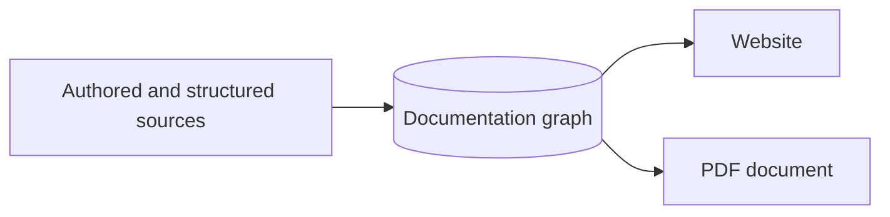

# Markdown File Collector

Write pages, guides, explanations, and examples in Markdown. GraphArch collects
the text, publication hints, and referenced assets into its documentation graph.
Website, specification, and PDF renderers then use that retained content, even
after the source files have been removed.

This collector documents [authored pages and guides](../documentable-things/authored-documentation.md).
Writing about an ontology does not declare its classes or properties; use the
[RDF File Collector](rdf-files.md) for the ontology itself.

## Start with a page

````markdown
---
title: Product guide
nav_order: 2
permalink: /guides/products/
grapharch:
  subject: urn:example:product-guide
---
# Product guide

Explain how publishers describe their products.

- [x] Publish an identifier
- [ ] Review the description

> [!NOTE]
> Keep identifiers stable between publications.

```json example
{"title": "UK Bonds", "type": "DataProduct"}
```
````

Place the file beneath your documentation content root. The
[website build guide](../usage/self-hosting.md) explains discovery, project
configuration, and publication. Frontmatter is optional; website builds use an
explicit title when supplied, otherwise the first heading, then the filename.
Invalid frontmatter fails collection rather than being replaced with defaults.

## Supported Markdown

GraphArch supports GitHub Flavoured Markdown alongside ordinary Markdown:

| Content | Publication behavior |
| --- | --- |
| Headings, paragraphs, emphasis, links, lists, and quotations | Retained as authored content, with links resolved for the selected publication. |
| Tables and strikethrough | Rendered in HTML and PDF. |
| Task lists | Checked and unchecked states remain distinct. |
| GitHub alerts | `[!NOTE]`, `[!TIP]`, `[!IMPORTANT]`, `[!WARNING]`, and `[!CAUTION]` become labelled callouts. |
| Fenced code | Language-labelled code receives static syntax highlighting where supported; code is never executed. |
| Footnotes | References link to a closing footnote list; repeated references reuse the same note. |

Add `example` after a fence's language, as in `json example` above, to request a
numbered example in specifications, companion websites, and PDFs. Keep a blank,
unquoted line between separate alert blocks. Markdown syntax inside code
examples remains literal.

### Tabs, callouts, figures, and included text

The collector also recognizes the supported Material-style tabs and admonitions,
collapsible content, figure captions, explicit anchors, and source-fragment
includes described in [content groups and callouts](../usage/content-groups.md).
Those constructs become retained documentation content; they do not require
MkDocs or its plugins during publication.

That guide contains the authoring syntax, include-root configuration, dependency
provenance, and limits. Local includes remain inside explicitly selected roots;
Git blob collection does not use the local-file include resolver.

## Images and diagrams

### Keep illustrations with the page

```markdown

```

The Markdown collector describes image references; publication builds schedule
specialized image collectors to retain their bytes. Website image paths resolve
from the page's directory and must remain inside the documentation content
root. A standalone local Markdown file uses its
parent directory as that root. Pinned repository Markdown resolves images inside
the selected Git revision. Supported HTTPS references are collected before
publication; rendering does not contact their hosts.

PNG, JPEG, and validated SVG images retain their original bytes and source
provenance. Supply meaningful alternative text. See the
[Image Collector](images.md) for file and decoding budgets, safe SVG rules,
interactive SVG navigation, and light/dark image variants. Missing assets,
unsafe SVG content, and paths escaping the selected root fail explicitly.

### Draw a flowchart in Markdown



Fenced Mermaid **flowcharts** become retained static SVG during the document
stage. The supported subset includes labelled nodes, subgraphs, and edges.
Other Mermaid diagram types, interactive links, and initialization directives
are rejected. HTML and PDF reuse the retained diagram without a browser-side
diagram service.

For separately authored `.puml` files, use the
[PlantUML Collector](plantuml.md). Its configuration connects the generated SVG
to a normal Markdown image reference; its local renderer and include rules are
separate from fenced Mermaid support.

## Page identity and navigation

| Frontmatter | Purpose |
| --- | --- |
| `title` | Supplies the page title. |
| `grapharch.subject` | Identifies the documented subject with a stable IRI. |
| `parent` and `nav_order` | Place the page in website navigation. |
| `permalink` | Gives the page an explicit website route. |
| `grapharch.fragment` and `grapharch.fragments` | Identify reusable whole-page or selected-section content. |

Logical identity and navigation are independent of the physical filename.
See [content and documentation hints](../features/content-and-hints.md) for the
relationship between subjects, fragments, scopes, profiles, and publication
placement. The next section shows how to select shared Markdown sections.

## Collect a standalone fragment

A website build discovers pages and their publication hints. Repository
collection reads the selected revision, retaining its source provenance. To
collect one local Markdown fragment without website navigation:

```sh
grapharch publication collect --store output/kg \
  --project urn:example:project --collector urn:example:product-guide \
  --kind markdown --source docs/product-guide.md
```

For repository selection and caching, see the
[Repository Publication Collector](repository-publications.md). All modes retain
content in the KG; renderers do not reopen Markdown files to reconstruct it.

## Validation and boundaries

- MDX components and embedded JavaScript are not executed.
- Arbitrary raw HTML is rejected. Only explicitly supported authoring forms,
  such as those documented for figures, anchors, and SVG images, are converted
  into semantic content.
- Markdown input is bounded to 1 MiB. Content groups, includes, images, and
  reusable sections have their own documented budgets.
- Invalid hints, malformed supported constructs, missing references, and
  unsupported diagram syntax fail explicitly.

## Reuse canonical content in several publications

Give shared content an explicit fragment IRI. Optional section hints map heading
anchors to stable fragment IRIs; the heading anchor is the lowercase title with
spaces replaced by hyphens, with numeric suffixes for repeated headings.

```markdown
---
title: Product guide
grapharch:
  subject: urn:example:product-guide
  fragment: urn:example:content:product-guide
  fragments:
    product-identity: urn:example:content:product-identity
---
# Product guide

## Product identity

Write this explanation once. Both the website and the overview use this text.

## Implementation detail

Keep more detailed instructions available to the website's readers.
```

The whole-body fragment includes all authored Markdown after the frontmatter.
Each section fragment retains its heading and prose through the next heading,
including lists and code blocks. It records `ga:derivedFrom` the whole fragment;
its topic retains hierarchy and source-contribution metadata. A standalone or
pinned Git collector emits these same identified sections when hints are present.
If a configured Git collector also specifies `ga:fragment`, it must agree with
the whole-body hint.

Select the shared section through the existing scope, profile, and placement
model. The profile chooses content and presentation; it does not rewrite prose.

```turtle
@prefix ga: <https://ekgf.org/ontology/grapharch#> .
@prefix dct: <http://purl.org/dc/terms/> .

<urn:example:overview-scope> a ga:Scope ;
    ga:include <urn:example:product-guide> ;
    ga:traverse ga:topic ; ga:maxDepth 1 .
<urn:example:overview-profile> a ga:Profile ; ga:style "overview" ;
    ga:placement <urn:example:overview-placement> .
<urn:example:overview-placement> a ga:Placement ; ga:order 1 ;
    ga:component <urn:example:identity-component> .
<urn:example:identity-component> a ga:Component ;
    dct:title "Product identity" ;
    ga:fragment <urn:example:content:product-identity> .
```

The website can retain the whole guide while the PDF selects only product
identity. Editing the canonical paragraph updates both publications. Renderers
consume the retained fragments in the pinned KG, including after export and
restoration; they do not reread or copy the Markdown source during rendering.
Missing section anchors, invalid IRIs, duplicate section IRIs, and conflicting
whole-fragment hints fail explicitly. Each file supports at most 1,024 section
hints, matching the existing section budget.
