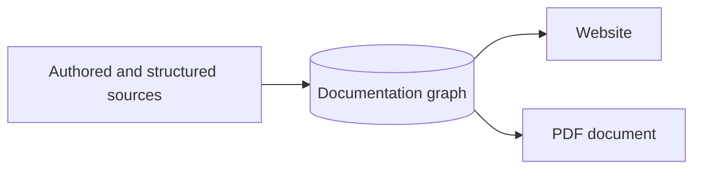

# Author explanations in Markdown

GraphArch supports GitHub-flavoured Markdown for authored documentation:
headings, links, emphasis, lists, fenced code, tables, strikethrough, task-list
checkboxes, and GitHub-style callouts. Website frontmatter supplies topic titles,
stable subjects, navigation order, parents, and permalinks.

## Keep normal Markdown readable

- [x] Completed tasks retain their checked state.
- [ ] Incomplete tasks remain unchecked.

| Construct | Source example |
| --- | --- |
| Emphasis | `**Important**` |
| Strikethrough | `~~Superseded~~` |
| Fenced code | A language-labelled source example |

Start a blockquote with `[!NOTE]`, `[!TIP]`, `[!IMPORTANT]`, `[!WARNING]`, or
`[!CAUTION]` to create a labelled callout. Markers inside code stay literal.

> [!NOTE]
> The documentation you are reading is collected into a KG and published by
> GraphArch itself.

## Include retained images and diagrams

Supported PNG, JPEG, and SVG images are collected into the KG. Explicit Markdown
file collection accepts HTTPS image URLs; repository sources also resolve
relative images at the selected Git revision. Rendering restored content does
not reopen the source image or contact its host. Supply meaningful alternative
text; unsafe SVG content, unsupported URLs, and oversized assets fail explicitly.

Fenced Mermaid **flowcharts** become static SVG diagrams during the document
stage. That subset supports labelled nodes, subgraphs, and edges. Other Mermaid
diagram types, interactive links, and initialization directives are rejected.
The same retained diagram can appear in HTML and PDF without a browser-side
diagram service.

## Give content a stable identity

Use a `grapharch.subject` hint in frontmatter to identify the documented subject.
Website-specific fields such as `parent`, `nav_order`, and `permalink` control
navigation independently of the file's physical location. See
[reusable content and hints](../../content-and-hints.md) and the
[website build guide](../../../usage/self-hosting.md).

The current pipeline does not execute MDX components or embedded scripts. Raw
HTML in Markdown is rejected. Mermaid support is a defined flowchart subset,
not a claim to support every Mermaid diagram type.
