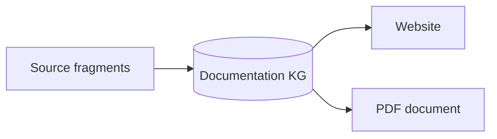

# Markdown files

Grapharch supports **GitHub-flavoured Markdown (GFM)** for authored documentation,
including tables, task-list checkboxes, strikethrough, and GitHub-style callouts.
Headings, paragraphs, links, emphasis, lists, and fenced code blocks are supported
as well. The same parser configuration is used for collection and rendering.

Each Markdown-file collector reads one source. YAML frontmatter supplies a title,
a stable logical identity, and publication hints. Sections become topics and
ordered documentation fragments in the KG; fenced code blocks also become
queryable examples. Renderers publish those collected fragments from a pinned
revision.

## Task lists

Use `- [ ]` for an incomplete task and `- [x]` for a completed task:

- [x] Collect Markdown and frontmatter into the documentation KG.
- [x] Render checked and unchecked task states.
- [ ] Add more examples to your documentation.
  - [ ] Include a nested task when useful.

The generated website preserves the completion state and uses the checkbox as
the list marker.

## Tables and strikethrough

| Construct | Syntax | Result |
| --- | --- | --- |
| Emphasis | `**important**` | **important** |
| Strikethrough | `~~superseded~~` | ~~superseded~~ |
| Inline code | Backticks around source text | `grapharch` |

## Callouts

Start a blockquote with `[!NOTE]`, `[!TIP]`, `[!IMPORTANT]`, `[!WARNING]`, or
`[!CAUTION]`. Grapharch renders the type as a labelled callout rather than
printing the marker.

> [!NOTE]
> This page is collected into the KG and rendered by Grapharch itself.

> [!TIP]
> Give documents stable identities in frontmatter so files can move without
> changing their logical identity.

> [!IMPORTANT]
> Local links and heading references must resolve in the selected publication.

> [!WARNING]
> A failed build preserves the previous complete publication.

> [!CAUTION]
> Removing a topic can invalidate links from other documentation fragments.

Markers inside inline code or fenced code blocks remain literal source text:

```markdown
> [!NOTE]
> Write the note here.
```

## Mermaid flowcharts

Fenced `mermaid` flowcharts become static SVG diagrams during the document
stage. Website builds run this stage automatically. The diagram bytes stay in
the documentation KG, so publishing works offline after the source files are
removed. The same retained diagrams can be used in specification and PDF
targets. Browser JavaScript and external diagram services are not required.



The current native subset supports flowcharts, including labelled nodes,
subgraphs, and edges. Other Mermaid diagram types, interactive links, and
initialization directives are rejected explicitly. Each diagram is limited to
32 KiB of source, 128 nodes, 256 edges, and 32 subgraphs; each fragment may
contain up to sixteen diagrams. Invalid or unsupported diagrams fail the build.
Custom publication pipelines must run the Mermaid document stage before assembly.

## Frontmatter

```yaml
---
title: Example topic
parent: Usage
nav_order: 2
permalink: /usage/example/
grapharch:
  subject: urn:example:documentation:topic
---
```

See [Self-hosted documentation](../../../usage/self-hosting.md) for a complete
website build and the relationship between source files, logical topics, and
publication pages.

## Images

PNG, JPEG, and SVG images at HTTPS URLs are collected into the documentation
graph. Shared URLs create one image input per project batch. The website,
specification, and PDF use those retained bytes, so rendering an exported graph
does not contact the image host or reopen the original Markdown files.

Images need alternative text. Active SVG content, unsafe URLs, oversized images,
and content that disagrees with its declared format are rejected. Repository
sources also resolve relative images against the selected Git revision.

## Current boundaries

The current pipeline does not execute MDX or embedded scripts. Raw HTML in
Markdown and uncollected local images are rejected. Ordinary Markdown-file images require HTTPS URLs; relative images need a
repository source. These boundaries are explicit; unsupported content fails the
build.
