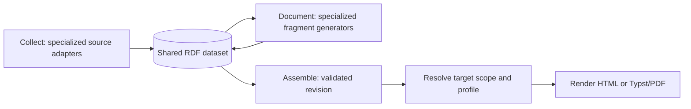

# Architecture

The delivery contract is [the architecture and deliverables specification](deliverables.md).
It defines five stages sharing one RDF dataset:

Subjects, authored and generated fragments, provenance, and instructions have
stable graph identities. Website navigation and PDF reading order belong to
target-specific plans, not to collected content. One ontology need not be one
book. Multiple projects and publication targets can reuse the same subjects.

Collectors stream bounded contribution chunks through bounded Tokio channels.
A backend write coordinator controls batching and writer concurrency. Completed
contributions are assembled into a validated revision before publication;
partial or superseded attempts cannot replace valid state. See the delivery
specification for backpressure, cancellation, and incremental preview contracts.

ReSpec is a named migration reference; see the [feature compatibility map and
exact-output acceptance contract](respec-compatibility.md). Authority identity is
a graph concern, independent of renderer implementation.

## Existing implementation and replacement boundaries

The existing Rust source, loader, documentor, and Typst code is the starting
point. Its separate loader/model stores, random book/chapter identities,
example.org vocabulary, and source-to-book mapping are prototype behavior, not
the new publication contract. Markdown processing and HTML generation remain
incomplete in that prototype. New graph-backed publication definitions live in
`src/publication`; implementation status is recorded on the [status page](../status.md).

Embedded Oxigraph and external RDF4J transactions implement the same stage
interfaces. External KG connections must demonstrate SERIALIZABLE isolation
using a predicate-range/phantom conflict probe; standard SPARQL Query/Update
endpoints alone are rejected as writable KG backends. Generic endpoints remain
supported collection sources through specialized CONSTRUCT/DESCRIBE collectors.
See [SPARQL services](../../usage/sparql-endpoints.md) for configuration and
protocol limits. Backend support requires consistency and failure contract tests,
not merely successful query execution.

A persistent family build records a bounded ownership manifest using PROV and
Dublin Core terms. Discovery registers a pending document-stage contribution
before source I/O. Failed discovery blocks assembly; successful discovery retires
only missing managed contributions. Generated family bindings belong to the
document stage. Documentors pin collected-stage assertions, so a new run cannot
incorporate its own preceding generated output into its input revision. Historical
snapshots continue to reference their immutable contribution graphs. A VS Code extension is a later consumer
of the same long-lived incremental pipeline.
