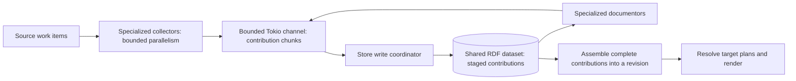

# Grapharch: documentation graph and publication architecture

**Status:** Implementation in progress. The acceptance criteria below remain the delivery contract.

## Purpose and design deliverable

Build on the existing Rust implementation to turn heterogeneous sources into a
shared, queryable documentation dataset, then publish independently from that
dataset. Support embedded Oxigraph, either in memory or on disk, and an external
SPARQL service through the same stage interfaces.

The first usable release produces DPROD specification HTML, a reader-oriented
static website, and a Typst PDF from the same graph revision. Each is a separate
publication target with its own scope, profile, structure, and destination.

This document records the proposed architecture and deliverables. Once reviewed,
reconcile it with [the architecture overview](README.md), and update the existing
design goals and status pages to distinguish implemented, planned, and deferred
capabilities. Preserve existing working-tree changes.

The current implementation provides useful source, loader, and generator code,
but creates stores per invocation, maps subjects directly into books and chapters,
and leaves several advertised capabilities unimplemented. The design must
explicitly replace those assumptions.

## Concepts and stage boundaries

Define these concepts in the documentation ontology:

| Concept | Definition |
|---|---|
| Documentation project | An identified configuration of sources, collector instances, scopes, and publication targets sharing a documentation dataset. |
| Collector | A source-aware adapter that reads a supported source format, recognizes its native hints, and contributes normalized RDF with provenance. A project can configure multiple instances of each collector type. |
| Documentable subject | Any identified thing that can be documented: ontology, class, use case, fund, portfolio, or another resource. |
| Source contribution | Source content, normalized hints, and metadata attributable to a project, collector instance, and source revision. |
| Documentation fragment | Authored or generated content with identity, subject relationships, format, and provenance. |
| Documentation scope | A reusable definition of included subjects, exclusions, traversal boundaries, and composed scopes. |
| Logical component | A meaningful unit such as an introduction, definition, requirement, example, or glossary, independent of output placement. |
| Publication profile | Audience, detail, style, and target-specific arrangement of selected components. |
| Publication target | A named output of a project, binding a scope, publication profile, renderer, and destination or base URL. Several targets may use the same renderer. |
| Graph revision | An identifiable, validated state of the documentation dataset available for publication. |
| Publication job | A run of a target against a specified graph revision that produces artifacts and a provenance manifest. |

Use five explicit stages:

1. **Collect:** run the project's configured collectors to discover and read
   files, graphs, or external records; extract existing fragments, translate
   native hints to RDF, and preserve source identities and revisions.
2. **Document:** read collected RDF subjects, fragments, and normalized
   instructions; generate additional documentation fragments from those
   subjects. This stage never discovers or interprets source-native hints.
3. **Assemble:** combine contributions, resolve references, validate instructions,
   and commit a publishable graph revision.
4. **Resolve publication:** evaluate each requested target's scope and profile
   against that revision, recording a publication plan with target placements.
5. **Render:** read a target's resolved plan and content from the same dataset;
   generate HTML, Typst/PDF, or a future format, and record the publication result.

Stages expose Rust library interfaces and independently invocable CLI operations,
plus an orchestration command for running a complete pipeline. The shared RDF
dataset is the handoff between stages. Rendered files are output artifacts, not
another documentation store.

### One shared dataset and existing stores

All five stages operate on the same logical RDF dataset. Named graphs distinguish
source contributions, normalized instructions, generated fragments, validated
revisions, target plans, and publication records. These are ownership and lifecycle
boundaries within one store, not separate per-stage stores.

The dataset may already exist. Grapharch opens the configured store and operates
on the project's registered graphs; it never assumes an empty store or clears
unrelated data. Pre-existing domain graphs can be selected as collector inputs.
Pre-existing Grapharch definitions can be registered as authored contributions.
Merely finding triples in a store does not make them members of every project.

Subjects and fragments have stable identities. Placement belongs to the
publication plan: one fragment can appear in multiple publications and
arrangements. Input named-graph identity and provenance must survive collection
even when contributions are placed in Grapharch-managed graphs.

### Idempotence and revision lifecycle

Every stage is independently idempotent: the same identified inputs, instructions,
configuration, and implementation versions produce the same effective RDF output
and stable identities. Repeating an unchanged stage does not accumulate fragments,
plans, or content revisions. Run diagnostics may be recorded separately from
semantic content.

Source RDF, authored instructions, and generated documentation remain
distinguishable in the dataset. Updating a source replaces its previous
contribution, including deleted content, without deleting independently authored
instructions.

Each stage records its input dependencies and replaces only the contributions it
owns. Changed collector results invalidate dependent documentation and target
plans. A removed source is reconciled only after successful enumeration of the
configured source set, or an explicit removal instruction; a failed scan must not
be treated as evidence of deletion.

Incomplete work remains distinguishable from a committed revision. Failed stages
return errors and leave the last valid revision available. A publication pins a
validated revision and never reads a mixture of old and new contributions.
Running a stage independently requires its recorded prerequisites to be complete;
stale or missing prerequisites produce an error.

Rendering the same plan replaces the target's own artifact set without duplicate
pages or stale generated files. Reproducibility includes explicit publication
dates, template versions, and assets; byte-identical PDF output is not assumed
unless verified for the chosen toolchain.

### Storage backends

| Backend | Intended use | Lifecycle |
|---|---|---|
| Embedded Oxigraph, in memory | Small projects, local previews, GitHub Actions jobs | Stages share one store in one process. Explicit dataset export/import carries state across processes or CI jobs. |
| Embedded Oxigraph, on disk | Local projects needing persistent incremental work | Independent invocations reopen the same dataset. |
| External SPARQL service | Existing managed stores and shared documentation infrastructure | Query and update services address the same logical dataset; stages use the backend abstraction. |

Persistent and external modes must support publication after restarting
Grapharch, without rereading the original sources. In-memory mode has the same
semantics during its lifetime; restoring an exported dataset is required after
the process exits.

External support requires SPARQL Query and Update, named graphs, permissions for
Grapharch-owned graphs, and the consistency guarantees needed to commit and read
complete revisions. Query and update URLs may differ. A read-only endpoint can
serve as a collector source, but cannot host the complete writable pipeline.

The [SPARQL protocol](https://www.w3.org/TR/sparql11-protocol/) defines query and
update operations over HTTP; [SPARQL Update](https://www.w3.org/TR/sparql11-update/)
defines graph mutations. Support for these interfaces alone is insufficient to
assume transactions across multiple requests. D2 must define and test revision
visibility, interrupted writes, and writer coordination for supported backends.
An endpoint that cannot meet the contract fails explicitly; Grapharch must not
silently switch to a local store. Independent pipeline coordinators writing the
same project's managed graphs must be serialized or rejected. Within one
coordinator, backend-controlled write concurrency follows the contract below.

### Collectors own native hint interpretation

Each collector is small and specialized around one specific kind of input or
documentable thing, with one defined contribution contract. A Markdown-file
collector extracts authored fragments and frontmatter instructions; a SPARQL-file
collector extracts a statement and its documentation pragmas. A record collector
supports a specific configured record mapping. The orchestrator composes these
components; it does not become a collector that understands every format.

For RDF inputs, collection preserves source assertions and normalizes annotation
hints. Small documentors separately generate fragments for specific semantic
constructs, such as an OWL class, OWL property, SHACL node shape, or SKOS concept.
These documentors consume collected RDF, not original files. Neither collectors
nor documentors choose website navigation or PDF placement.

A project can configure any number and mixture of collector instances. Sources
may overlap deliberately; contributions retain their collector identity so one
collector cannot delete another's work. Execution uses bounded concurrency and
must not depend on collector completion order.

| Collector | Native input and hints | Contribution |
|---|---|---|
| Markdown | Markdown body and frontmatter | Existing fragments and normalized RDF instructions |
| SPARQL statement | `.rq` and `.sparql` source with comment pragmas | Documentable statements, descriptions, and normalized RDF instructions |
| OWL | Ontology RDF with `grapharch:` annotation triples | Documentable subjects, source assertions, and documentation instructions |
| RDF instructions | Standalone RDF definitions | Project, scope, component, profile, and target definitions |
| External records | A format supported by a conversion collector | Subjects, fragments, and normalized instructions with record provenance |

Only collectors recognize native hint syntax. Document, assemble, resolve, and
render consume the resulting RDF instructions; none reparses frontmatter,
comment pragmas, or source annotations. Rendering a fragment's Markdown body is
content formatting, not hint extraction. The SPARQL statement collector documents
queries and updates as source artifacts; collecting a file does not execute it.

Hints use one semantic model regardless of their source syntax. Existing
Grapharch RDF instructions are preserved with provenance. Source order never
determines conflicting settings; invalid or conflicting instructions produce
actionable errors identifying their sources. Shared validation of normalized
instructions belongs to assembly, while malformed native syntax is a collector
error.

### Parallel collection and streamed graph writes

Collectors execute concurrently under explicit task and resource limits. They
stream RDF contribution chunks through a bounded Tokio channel to a central
store write coordinator. Collectors do not write directly to the dataset. The
same contribution contract applies to generated fragments from documentors.

Bound both message size and queued bytes, as well as task count and message
count; a bounded channel alone does not bound memory when messages are unbounded.
Parsing and chunk production must stream rather than materialize a complete
corpus before sending. A slow writer applies backpressure to producers. Blocking
parsers or storage calls run outside Tokio's async executor threads under their
own bounded execution limits.

The backend adapter owns writer scheduling, transaction boundaries, and bounded
batching. It may use one writer or multiple coordinated writers according to
tested backend capabilities. Do not infer a single application writer merely
from an embedded backend's use of RocksDB. Establish the Oxigraph strategy with
contract tests and measurements. Concurrent writers must preserve contribution
ownership and revision consistency; source completion order cannot affect the
effective result. Batch limits include a maximum wait so throughput optimization
does not impose unbounded preview latency.

Each stream identifies its project, collector or documentor instance, source,
input revision, and contribution attempt. Explicit begin, chunk, completion, and
abort semantics distinguish complete contributions from interrupted work.
Completion is accepted only after all chunks for that attempt are durably staged
according to the backend contract. Channel closure, cancellation, parser errors,
and writer errors must never be interpreted as successful completion. Errors
propagate to the coordinator and affected producers rather than leaving tasks
blocked indefinitely on a channel.

Chunks remain unpublished until contribution completion and assembly commit a
validated revision. Successful replacement removes the previous owned
contribution's obsolete assertions; failed or cancelled attempts never replace
the last valid contribution. Late chunks from superseded attempts are rejected.
Multiple writer workers must account for in-flight chunks before accepting a
completion marker. Streaming transport does not itself provide atomicity.

### Incremental execution and editor previews

Fast feedback during authoring is a core execution requirement. A future Visual
Studio Code extension should reuse a long-lived Grapharch process, its configured
dataset, and reusable compilation resources to update a Typst/PDF preview while
source files change. The extension itself is a later integration; the pipeline
must support this execution model from its initial design.

Track dependencies from source contributions through generated fragments,
assembled revisions, scopes, target plans, and artifacts. Recollect only changed
inputs and invalidate affected dependants, including dependencies on absence,
scope membership, and shared configuration. A change that can affect a broad
query must invalidate that query's dependants; incremental processing cannot
assume every change has a single-subject impact. Unchanged independent work is
reused. A renderer may still recompile a complete affected document when required
by its engine, without forcing complete source recollection.

Debounce rapid edits, coalesce pending work, and cancel superseded attempts.
Cancellation must release channel capacity and bounded worker resources. Work
that cannot be interrupted safely may finish, but its stale result cannot be
promoted. Every render pins one validated graph revision and target definition.
Artifact promotion checks that the job is still current, preventing an older
render from overwriting a newer preview.

Invalid edits produce actionable diagnostics immediately when detected. The
viewer retains the last successfully published PDF with its revision and stale
status visible; it must not report the failed update as successful. Full builds
remain available and must produce semantically equivalent results to incremental
execution for the same inputs.

Measure both throughput and edit-to-preview latency. Benchmarks record corpus
size, hardware, backend, concurrency, queue and batch limits, peak memory, cold
build time, and warm-update p50/p95 latency, broken down by stage. D2 establishes
baseline measurements and explicit budgets; D6 verifies them with DPROD and a
larger pinned fixture. Do not claim real-time behavior without measured results.

### Multiple publication targets per project

One DPROD project can define, for example:

| Target | Renderer and profile | Intended destination |
|---|---|---|
| Specification | Static HTML, W3C/ReSpec-like specification profile | `https://ekgf.org/dprod/spec/` |
| Reader website | Static HTML, reader-oriented navigation and detail | `https://ekgf.org/dprod` |
| Review document | Typst/PDF, ordered document with review metadata | A configured PDF artifact path |
| OMG specification | HTML, an OMG-specific publication profile | A configured OMG site destination |

A target is independent of its output format: two HTML targets can have different
scopes, structures, styles, and base URLs. Profiles can be reused by targets.
Users can publish one selected target or all targets without rerunning collectors.
A future UI authors these same RDF definitions.

Targets have separate artifact ownership and job status. Publishing the reader
website must not erase a nested specification target. Overlapping output paths
require explicit composition or fail validation. Destination URLs inform links
and packaging; generating a target does not itself deploy it.

## Deliverables and acceptance criteria

### D0 — Architecture and delivery specification

**Artifacts:** updated architecture, terminology, pipeline diagram, milestone
definitions, and current-capability inventory.

**Acceptance:** every requested capability maps to a milestone; implemented
behavior is distinguished from proposals; no ingestion contract assumes one
ontology equals one book.

### D1 — Documentation ontology and executable examples

**Artifacts:** RDF vocabulary, validation constraints, Rust domain interfaces, and
small fixtures covering an ontology family, use case tree, and fund portfolio.

**Acceptance:**

- Standalone RDF can define projects, scopes, logical components, publication
  profiles, and multiple targets.
- Scopes support explicit inclusion/exclusion, bounded relationship traversal,
  and composition.
- Overlapping scopes reuse subjects and fragments.
- One component has different website and PDF placements.
- One project defines two HTML targets and a PDF target with independent scope,
  profile, and destination bindings.
- Collector instances and stage contributions have explicit ownership and
  provenance within a shared dataset.
- Fixtures define expected scope membership and reference-only external subjects.

Exact vocabulary terms and validation rules are finalized in this deliverable
before dependent implementation.

### D2 — Shared store, backend support, and idempotent stages

**Artifacts:** a backend abstraction with in-memory Oxigraph, on-disk Oxigraph,
and external SPARQL implementations; contribution tracking, revision handling,
query/export/import operations, independent stage commands, and orchestration.

**Acceptance:**

- All stages use one configured dataset, including a pre-existing populated store.
- Persistent stores can be closed, reopened, queried, and published; in-memory
  pipelines can export/import a dataset to resume in another process.
- The same backend contract tests pass for embedded modes and a real external
  SPARQL service, including query/update URL configuration and permissions.
- Repeating each unchanged stage does not duplicate fragments, plans, or content
  revisions, or change their identities.
- Changed and deleted source content updates the relevant contributions.
- Unrelated graphs and other collectors' contributions survive updates and
  removals; a failed scan does not remove previously collected content.
- Failed construction leaves the last valid revision available and returns an
  error.
- A publication uses one consistent revision throughout.
- Unsupported endpoint capabilities and competing writers fail explicitly;
  interrupted remote writes do not expose incomplete revisions as publishable.
- Processing does not require loading the whole corpus into memory.
- Slow-writer tests demonstrate bounded queued bytes, bounded tasks, and producer
  backpressure; writer failure and receiver closure unblock affected producers
  with errors.
- Backend contract tests cover single and concurrent writer scheduling where
  supported, including completion with chunks still in flight, aborted attempts,
  and rejection of superseded contributions.
- Dependency tracking, cancellation, and current-job checks support incremental
  execution; late results cannot replace newer state.
- A repeatable benchmark harness establishes throughput, peak-memory, and warm
  update latency baselines and records explicit performance budgets.

### D3 — DPROD ingestion and authoring

**Artifacts:** configurable collector registration and instances; Markdown with
frontmatter, SPARQL statements with comment pragmas, RDF instructions, and OWL/SHACL
collectors; RDF-to-fragment documentors; DPROD configuration and content mapping.

**Acceptance:**

- DPROD narrative, ontology terms, shape constraints, examples, references, and
  assets are represented.
- Equivalent instructions supplied through different supported hint formats
  resolve consistently.
- Multiple collector types and multiple instances of the same type run together;
  reordering their execution does not change the resulting documentation.
- Downstream stages work solely from collected RDF and never require access to
  native hints or original source files.
- `.rq` and `.sparql` files become documentable objects without executing their
  statements.
- Every generated fragment identifies its subject and source.
- Unsupported requested behavior fails explicitly.
- ReSpec-specific narrative and configuration are inventoried and converted into
  explicit Grapharch content and instructions.
- Collectors and documentors have narrow, separately tested contribution
  contracts; multiple configured instances reuse the same implementation.
- Collectors stream bounded chunks while other collectors are still running;
  tests cover interleaving, malformed input after partial output, cancellation,
  and independence from completion order.

### D4 — Scope and publication planning

**Artifacts:** scope resolver, profile interpreter, target-specific publication
plans, and an inspectable explanation of inclusion and placement.

**Acceptance:**

- Tests cover single subjects, families, trees, portfolios, exclusions, overlaps,
  and cyclic source relationships.
- Traversal terminates and respects declared boundaries.
- Required references resolve to included content or explicit external
  references.
- Website navigation and PDF reading order can differ while retaining shared
  content identity.
- Two HTML targets can resolve different scopes and arrangements from the same
  revision without duplicating or mutating shared fragments.
- One or all targets can be resolved independently; stale prerequisites and
  conflicting output ownership are reported explicitly.
- Ambiguous placement or ordering is reported rather than decided by load order.

### D5 — Static HTML and Typst/PDF publishers

**Artifacts:** a static HTML publisher with specification and reader-oriented
profiles, and a Typst source/PDF publisher, all selected through target definitions.

**Acceptance:**

- HTML works on static hosting, including a project subpath, without ReSpec or a
  Grapharch server.
- Website navigation, stable anchors, references, examples, and assets work.
- PDF includes title and publication metadata, contents, numbered sections,
  appendices, references, and glossary.
- Every output identifies its project, target, graph revision, scope, and profile.
- Rerendering a target updates only its owned artifacts; other targets remain
  intact, including a specification hosted beneath a reader website's base URL.
- Content is rendered appropriately for each target; Typst syntax is not embedded
  in shared generated prose.
- PDF layout is visually inspected, including long tables, code, links, and page
  breaks.
- Long-lived preview execution reuses compilation resources where supported;
  a superseded render cannot promote artifacts over the current job.
- Invalid edits retain the last successful preview with explicit stale status
  and diagnostics identifying the failed update.

### D6 — First usable release: DPROD

**Artifacts:** reproducible DPROD example project, CLI/library documentation,
authoring guide, adapter guide, and release acceptance report.

**Acceptance:**

- A pinned DPROD source revision produces specification HTML, reader website HTML,
  and PDF through documented target selections, individually and together.
- A content inventory demonstrates coverage of the existing specification;
  omissions are explicit.
- A clean restart can republish from persistent or exported graph state alone.
- A documented GitHub Actions example runs the full pipeline using in-memory
  Oxigraph without a separately installed database server.
- Cross-output checks verify shared subjects and references.
- Automated checks and visual review pass.
- Incremental and clean builds produce equivalent publication content after
  edits, deletions, configuration changes, and shared-reference changes.
- Benchmarks report cold-build throughput, warm edit-to-preview p50/p95 latency,
  and peak memory for pinned DPROD and larger fixtures against the D2 budgets.
- Deployment or replacement of DPROD's existing publication pipeline is a
  separate action.

Dependencies: D0 → D1 → D2 → D3 → D4 → D5 → D6. D1 fixtures guide tests throughout.

## Verification and subsequent deliverables

Write failing behavioral tests before implementing each capability. Test stage
contracts and end-to-end outcomes, including malformed hints, conflicting
instructions, missing references, source deletion, interrupted updates, and
publication from persisted state. Exercise per-stage idempotence, backend parity,
collector-order independence, multiple targets sharing a renderer, and isolation
between target outputs. Use controlled slow consumers and injected failures to
test backpressure, cancellation, channel closure, incomplete streams, and stale
render promotion. Compare incremental results with clean rebuilds after each
change sequence.

Subsequent deliverables remain explicit roadmap items:

- **External conversion collectors:** one working records-to-fragments collector
  using the collector contract established in D3, including native hint handling.
- **Broader domain support:** SKOS and EKGF use case adapters, plus a pinned
  ontology-family corpus demonstrating scale.
- **Draft comparison:** compare two graph revisions, identify additions, changes,
  removals, and moves, and render PDF margin annotations; final profiles suppress
  review annotations.
- **Additional formats and themes:** a declared MDX component subset, an OMG web
  profile, richer web profiles, Word, and PowerPoint, each with separate acceptance
  fixtures. OMG-specific content and presentation rules require actual templates.
- **Authoring UI:** edit the same RDF scope and publication definitions,
  round-trip them, and preview resolved membership and placement.
- **Visual Studio Code integration:** source watching, diagnostics, and live
  Typst/PDF preview through the long-lived incremental pipeline. Exercise rapid
  edits and invalid intermediate input without implementing a second pipeline
  inside the extension.

Defaults: retain Rust, use Oxigraph for embedded storage, and support external
SPARQL through a shared backend contract. Deliver architecture and milestone
detail now; defer exact schema and command syntax to D1. The first release targets
DPROD specification HTML, reader website HTML, and PDF, while generic scope
fixtures prevent DPROD-specific assumptions. Formal OMG template compliance
requires concrete template and review requirements and is not implied by
producing a PDF.
